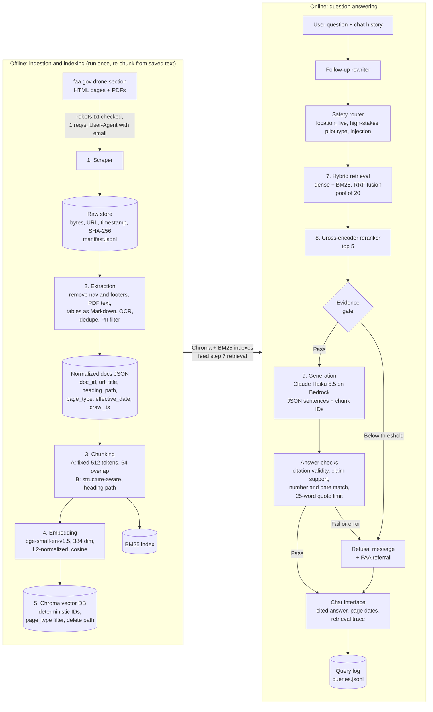
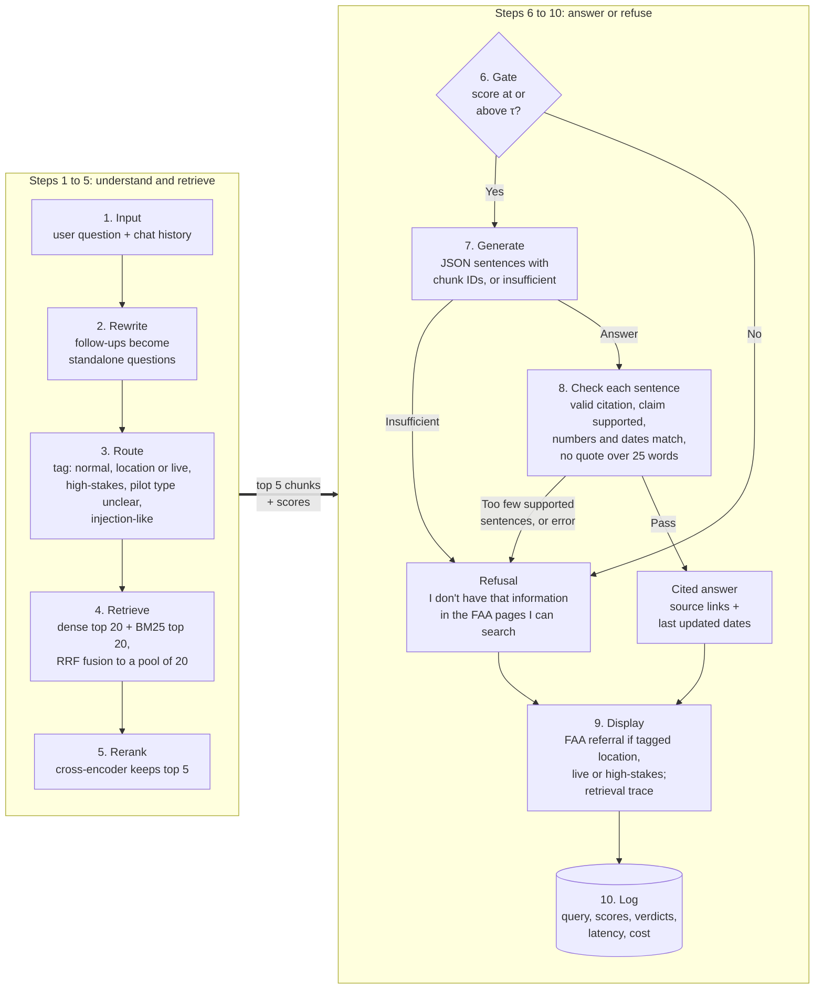
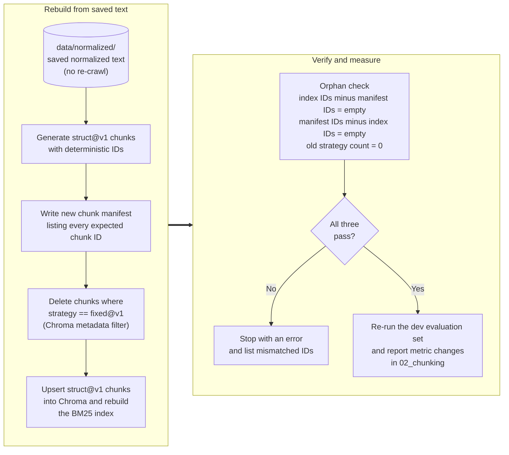

# SkyRules AI Diagrams (Mermaid source)

Rendered images are saved next to this file (`fig1_architecture.png`, `fig2_query_flow.png`, `fig3_rechunk.png`) and are embedded in the Word proposal.
GitHub also renders Mermaid code blocks directly, so these blocks can be pasted into Markdown files in the repo.

## Figure 1. System architecture (`fig1_architecture.png`)

## Figure 2. Query data flow (`fig2_query_flow.png`)

Step numbers match the data flow description in Section 8 of the proposal.

## Figure 3. Re-chunk migration (`fig3_rechunk.png`)

