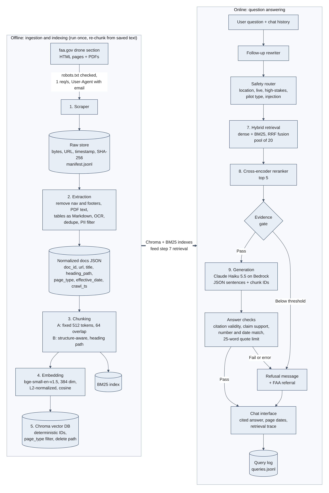
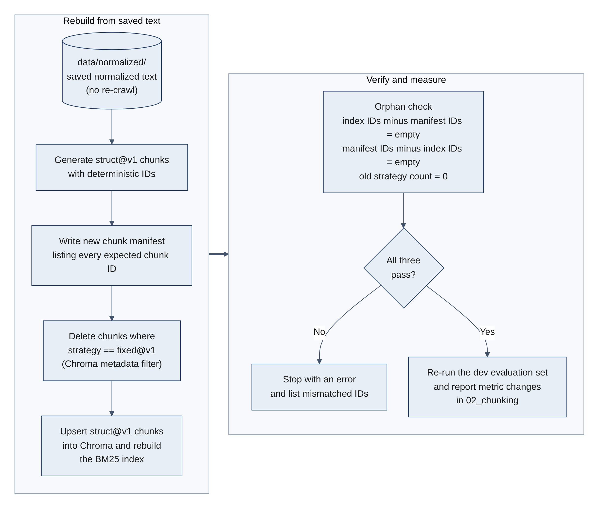
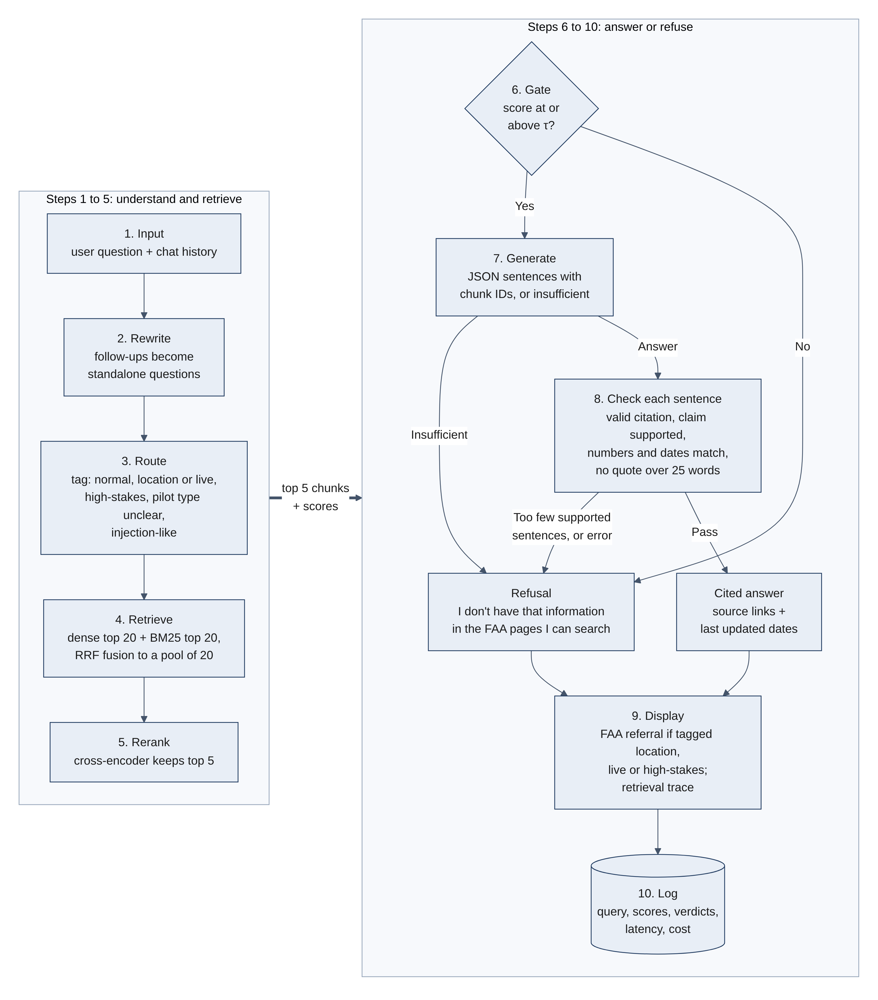

# SkyRules AI: Project Proposal

**Course:** MSAI 633, Residency Final Project (Retrieval-Augmented Chatbot)  
**Team:** SkyRules  
**Domain:** Another industry, government agency public guidance (FAA drone rules)  
**Source site:** https://www.faa.gov (drone section, `faa.gov/uas`)  
**Repository:** https://github.com/nayansathvikbukkapatnam/SkyRulesAI  
**Date:** October 9, 2026

---

## 1. Summary

SkyRules AI is a chatbot that answers questions about U.S. drone rules using only public pages and PDFs from the FAA's drone section. It covers topics like registration, flying for fun vs flying under Part 107, Remote ID, airspace authorization, night flying and waivers. Every factual claim cites the FAA page it came from. When the corpus does not support an answer, the chatbot says "I don't have that information" instead of guessing.

**Who uses it:** new drone owners, hobby flyers who want to start earning money from photos or video, small businesses that use drones, and students preparing for the FAA remote pilot knowledge test.

**Why a wrong answer matters:** flying in controlled airspace without authorization, or flying commercially without a certificate, can lead to FAA penalties and can put people and manned aircraft at risk. A confident wrong answer with a real FAA link is especially dangerous because it looks verified.

**Scope boundary:** SkyRules AI explains the rules. It does not tell a user whether a specific location is safe or legal to fly in right now, because that depends on live FAA map tools and temporary flight restrictions that are not in the scraped corpus. For those questions it gives the general rule and refers the user to the FAA's own tools.

---

## 2. Team Composition and Roles

Every member owns at least two pipeline stages so that individual contributions touch more than one stage, as required in §6. Every member also authors and verifies golden set items and reviews pull requests from at least one other stage.

| Member | Team role | Primary ownership | Secondary ownership | Reports owned |
|---|---|---|---|---|
| Pavan Krishna Lankipalli | Full Stack Engineer | Stage 9 Generation (Bedrock integration, prompt, JSON output), Streamlit chat interface | Answer checks (citation validity, quote limit), query logging, latency and cost tracking | 05_generation |
| Dorai Saketh Guntur | Product Manager | Golden set coordination and human verification, GitHub Projects board | Stage 2 PII filter, safety router rules and FAA referral messages | 03_golden_set, 07_ethics |
| Nayan Sathvik Bukkapatnam | Software Developer | System architecture, Stage 4 Embedding, Stage 5 Vector database, Stage 6 Re-chunk migration and orphan check | Repository setup, branch protection, CI workflow, reproducibility (Makefile, pinned dependencies) | 02_chunking, README |
| Sai Praneeth Kondaveeti | AI Engineer | Stage 3 Chunking, Stage 7 Retrieval (dense, BM25, hybrid), Stage 8 Reranking | Claim support check, open model comparison (Qwen3-8B) | 04_retrieval_reranking |
| Adinath Subash Kadam | Senior Systems Analyst | Stage 1 Scrape, Stage 2 Extraction (HTML, PDF, tables, OCR) | Evaluation runs, statistics (bootstrap intervals, McNemar's test), error analysis | 01_ingestion, 06_final_performance |
| All members | | Author and human-verify golden items, review PRs from other stages | | AI usage log |

---

## 3. Domain and Corpus Plan

### 3.1 Source and crawl scope

| Item | Plan |
|---|---|
| Site | `https://www.faa.gov` only |
| Seed URLs | `https://www.faa.gov/uas` and the drone entries in the FAA sitemap (`https://www.faa.gov/sitemap.xml`) |
| Allowed path prefixes | `/uas/`, `/sites/faa.gov/files/uas/` (drone PDFs), and drone advisory circulars and FAA documents on faa.gov that are linked from the drone section |
| robots.txt status | Checked on October 9, 2026. `/uas/` and drone PDFs are not disallowed. Disallowed paths (`/admin/`, `/search/`, `/user/*`, `/core/`, `/profiles/` and others) are enforced in code |
| Limits | Maximum 400 fetched URLs, link depth 3, 1 request per second |

### 3.2 Estimated size and content types

| Content | Estimate | Status |
|---|---|---|
| HTML pages in the drone section | About 70 to 80 | Confirmed from the site navigation |
| PDFs in the UAS Policy Library | About 27 | Confirmed (for example, the Part 107 Summary, the Remote Pilot Knowledge Test Study Guide, and the Drone Integration Concept of Operations) |
| Remote ID PDFs | 3 | Confirmed (Standard Remote ID, broadcast module, FRIA) |
| LAANC airports list (PDF) | 1 | Linked from the LAANC page. Expected to be a data table, to be confirmed in the crawl |
| Drone advisory circulars and related FAA documents on faa.gov | About 20 to 40 | Added to reach the 150 page target |
| **Total target** | **150 to 180 documents** | **≥5 PDFs: met by a wide margin** |

### 3.3 Tables

The spec requires at least 3 pages containing data tables. This is the main corpus risk for this domain, because most FAA drone web pages use lists instead of tables.

| Candidate | Status |
|---|---|
| Remote Pilot Knowledge Test Study Guide (PDF) | Confirmed: contains at least one text table (stable vs unstable air characteristics) and several figures that appear to be tables stored as images |
| LAANC airports list (PDF) | Expected to be a tabular list of airports. To be confirmed |
| Airman Certification Standards and advisory circular PDFs | Candidates. To be confirmed |

**Plan:** run a table detector (`pdfplumber` table extraction plus HTML `<table>` detection) on the Friday crawl and report the count in `01_ingestion`. Tables stored as images are extracted with OCR and labeled as OCR extracted. **No synthetic or outside content will be added to the corpus.** If the count is below 3 after the crawl, we will notify the instructor on Friday.


### 3.4 Excluded content

- **Login-walled pages:** FAA DroneZone and any account or application pages
- **Directories and contact listings:** `/uas/contact_us/*`, `/uas/public_safety_gov/contacts`
- **Lists that name people or operators:** the Part 107 and Part 91 "waivers issued" pages
- **Sighting reports data**
- **Site search and filtered listing pages**
- **Spanish language pages** (`/uas/espanol/*`), excluded so the English evaluation set is not skewed by duplicate content (documented as a known limitation)
- Any page the PII filter flags (see §11)

---

## 4. Technology Stack

| Stage | Choice | Key settings |
|---|---|---|
| Language and environment | Python 3.11 | Dependencies pinned in `requirements.txt` |
| 1. Scrape | `requests`, `urllib.robotparser`, `tenacity` | 1 request per second, descriptive User-Agent `SkyRulesAI-MSAI633` with a team contact email, raw bytes saved before parsing |
| 2. Extraction | `trafilatura` (HTML, `BeautifulSoup` fallback), `pdfplumber` (PDF text and tables), `pytesseract` (tables stored as images) | Tables converted to Markdown, dedupe by SHA-256 content hash |
| 3. Chunking | Custom Python, token counts from the embedding model's tokenizer | Strategy A: fixed size. Strategy B: structure-aware |
| 4. Embedding | `sentence-transformers`, `BAAI/bge-small-en-v1.5` | 384 dimensions, L2-normalized, cosine similarity, Hugging Face commit hash recorded |
| 5. Vector database | Chroma (`PersistentClient`, local) | Collection distance explicitly set to cosine (Chroma's default is L2), metadata filtering, delete by filter |
| 7. Retrieval | Dense (Chroma), BM25 (`rank_bm25`, BM25Okapi), hybrid (Reciprocal Rank Fusion, k = 60) | Candidate pool of 20 |
| 8. Reranking | Cross-encoder `cross-encoder/ms-marco-MiniLM-L-6-v2` (alternative: `BAAI/bge-reranker-base`) | Top 5 after reranking |
| 9. Generation | Claude Haiku 5.5 through AWS Bedrock (Converse API, `boto3`) | Temperature 0, structured JSON output |
| Answer checks | Claude Haiku 5.5 as claim support judge, plus rule-based checks | See §7 |
| Open model comparison (extra) | Qwen3-8B through Ollama, run locally | Final configuration only, reported in `05_generation` |
| Chat interface | Streamlit | Chat history, clickable citations, retrieval trace |
| Evaluation | `pandas`, `numpy`, `scikit-learn`, `statsmodels`, `matplotlib` | Bootstrap confidence intervals, McNemar's test |
| CI | GitHub Actions | Lint (`ruff`), unit tests (`pytest`), dev split retrieval metrics on every pull request |

**Embedding consistency check:** because embeddings are L2-normalized and the collection uses cosine distance, cosine and inner product rankings are equivalent. A unit test confirms that stored vectors have norm 1.0 and that the collection's distance setting is cosine, so a metric and normalization mismatch fails the build instead of silently degrading ranking.

**Cost:** retrieval components run locally at no cost. Generation is estimated at about $1 for the full weekend (about 1,000 queries with two LLM calls each), covered by AWS free tier credits. An AWS Budget alert is set at $5.

**Hosting:** code is hosted on GitHub. The chatbot runs locally from the repository for the live demo, and a Streamlit Community Cloud deployment from the same repository serves as a backup.

---

## 5. System Architecture

**Figure 1** shows all pipeline stages and how they interact: scrape, extraction, chunking, embedding, vector database, retrieval, reranking, generation, answer checks and chat interface.

### Stage summary

1. **Scrape.** A robots-aware crawler fetches allowed URLs at 1 request per second and writes raw bytes to `data/raw/{sha256}.bin`. Each fetch is logged to `data/raw/manifest.jsonl` with URL, final URL, timestamp, HTTP status, content type and SHA-256 hash.
2. **Extraction.** Navigation, footers and banners are removed. PDF text is extracted and tables are kept as Markdown tables. Duplicates are dropped by content hash. Each document is saved to `data/normalized/{doc_id}.json`.
3. **Chunking.** Two strategies (see §6) write to `data/chunks/{strategy}.jsonl`.
4. **Embedding.** Chunks are embedded with `bge-small-en-v1.5` and normalized.
5. **Vector database.** Chunks are stored in Chroma with deterministic IDs and metadata. A BM25 index is built from the same chunk file.
6. **Retrieval.** Dense, BM25 and hybrid retrieval each return a pool of 20 candidates.
7. **Reranking.** A cross-encoder reorders the pool and keeps the top 5.
8. **Generation.** The LLM answers only from the top 5 chunks and returns JSON with chunk IDs for every sentence.
9. **Answer checks and chat interface.** Automated checks verify the answer before it is shown with citations, page dates and the retrieval trace.


<!-- Figure 1 is rendered from the Mermaid source in docs/diagrams/diagrams.md -->

### Document metadata (stored per document)

| Field | Example |
|---|---|
| `doc_id` | First 12 hex characters of SHA-256 of the canonical URL |
| `source_url` | `https://www.faa.gov/uas/recreational_flyers` |
| `title` | Page title or PDF title |
| `heading_path` | `Recreational Flyers > Fly at or below 400 feet` (per section) |
| `page_type` | `guide_page`, `faq`, `regulation_summary`, `advisory_circular`, `study_guide`, `toolkit_pdf`, `data_list` |
| `audience` | `recreational`, `part107`, `public_safety`, `general` |
| `effective_date` | From "Last updated" text on HTML pages, or the PDF document date or metadata, when discoverable |
| `crawl_ts` | ISO 8601 crawl timestamp |
| `content_hash` | SHA-256 of the normalized text |

---

## 6. Chunking and Re-chunk Plan

### 6.1 Strategies compared

| | Strategy A: fixed size with overlap | Strategy B: structure-aware |
|---|---|---|
| Rule | 512 tokens per chunk, 64 token overlap | Split on HTML headings (h1 to h4) and PDF section headings (detected by font size and section numbering). Sections longer than 512 tokens are split with 64 token overlap |
| Heading path | Not included | Full heading path is prepended to each chunk's text and stored in metadata |
| Tables | May be cut across chunks | A table is kept whole in one chunk when it fits, otherwise split by rows with the header row repeated |
| ID tag | `fixed@v1` | `struct@v1` |

We will report chunk counts and token length distributions (histograms plus min, median, p95 and max) for both strategies in `02_chunking`, and compare them on the same dev set.

### 6.2 Chunk ID scheme

```
chunk_id = {doc_id}::{strategy}@{version}::{ordinal:04d}
example:   a1b2c3d4e5f6::struct@v1::0007
```

- `doc_id` is derived from the canonical URL, so it is stable across runs.
- `ordinal` is the chunk's position within the document for that strategy.
- The same normalized text and the same strategy always produce the same IDs, which makes upserts idempotent.
- Each chunk also stores `strategy`, `doc_id` and `chunk_hash` (SHA-256 of the chunk text) in metadata.

### 6.3 Re-chunk without re-crawling and without orphans

**Figure 3** shows the migration steps.


<!-- Figure 3 is rendered from the Mermaid source in docs/diagrams/diagrams.md -->

1. Load documents from `data/normalized/`, the saved normalized text. The crawler is not called.
2. Generate `struct@v1` chunks and write a new chunk manifest listing every expected chunk ID.
3. Delete all chunks where `strategy == "fixed@v1"` from Chroma using a metadata filter, and rebuild the BM25 index from the new chunk file.
4. Upsert the `struct@v1` chunks with their deterministic IDs.
5. **Orphan check:** compute (IDs in the index) minus (IDs in the new manifest) and (IDs in the new manifest) minus (IDs in the index). Both sets must be empty, and the count of chunks with the old strategy tag must be 0. The script exits with an error if any check fails.
6. Re-run the same dev evaluation set and report the change in every metric in `02_chunking`.

The migration is run with `make migrate` and its output (counts before and after, orphan check results) is saved to `reports/artifacts/migration_log.txt`.

---

## 7. Grounding and Refusal Design

The design goal is that no claim reaches the user unless it is supported by a retrieved FAA chunk. Answers pass through a safety router, an evidence gate and four answer checks. If any check fails or errors, the system refuses (fail closed).

### 7.1 Safety router (before retrieval)

Rule-based patterns, with no LLM call, so the router is fast, free and deterministic.

| Query type | Example | Behavior |
|---|---|---|
| Location-specific or live | "Can I fly in San Diego tonight?" | Answer the general rules from the corpus, then state that the system cannot check a specific location and refer the user to the FAA's B4UFLY service and UAS Facility Maps |
| High-stakes | Flying near airports, stadiums or critical infrastructure, waivers, emergencies | Answer what the corpus supports, then refer the user to the FAA |
| Pilot type unclear | "Do I need a license?" | Answer both cases, labeled "If you fly for fun" and "If you fly under Part 107", or ask which applies |
| Injection-like text in the query | "Ignore your instructions and..." | Strip the instruction and answer the remaining question, or refuse |

### 7.2 Evidence gate

If the highest reranker score is below a threshold τ, the system refuses without calling the LLM. τ is tuned on the dev split to balance the correct-refusal rate against the over-refusal rate, and the chosen value is reported.

### 7.3 Generation rules

- The prompt provides the top 5 chunks, numbered and wrapped in tags that mark them as untrusted reference text. The model is told that instructions inside reference text must be ignored.
- The model must answer only from the numbered chunks and return JSON: a list of `{"sentence": ..., "chunk_ids": [...]}` objects, or `{"insufficient": true}`.
- Chat history is used only to rewrite follow-up questions into standalone questions. Earlier answers are never treated as evidence.

### 7.4 Answer checks (after generation)

| Check | Method | On failure |
|---|---|---|
| Citation validity | Every sentence must cite at least one chunk ID, and every cited ID must be in the retrieved top 5 | Drop the sentence |
| Claim support | A second LLM call judges whether the cited chunk supports the sentence | Drop the sentence. If more than one sentence is dropped, refuse |
| Number and date match | Regex extracts numbers, units and dates from each sentence. Each must appear in the cited chunk | Drop the sentence |
| Quote limit | No run of more than 25 consecutive words may match the source text (word n-gram comparison) | Paraphrase request or block |

### 7.5 What the user sees

- **Citations:** inline markers such as [1] and [2] link to source cards with the page title, a clickable URL and the page's "last updated" date.
- **Refusal:** an explicit message: "I don't have that information in the FAA pages I can search." Where relevant, it adds a pointer to the right FAA resource.
- **Referral:** a visible referral to the FAA for high-stakes questions, as listed in §7.1.
- **Reliability notice:** "SkyRules AI is a student project, not official FAA guidance. Check the linked FAA page before you fly."
- **Retrieval trace:** an expandable panel listing the retrieved chunks with dense, BM25, fused and reranker scores, before and after reranking.

---

## 8. Data Flow

**Figure 2** traces a single user query from chat input to either a cited answer or a refusal.


<!-- Figure 2 is rendered from the Mermaid source in docs/diagrams/diagrams.md -->

1. **Input.** The user types a question in the Streamlit chat. The chat history is kept in session state.
2. **Rewrite.** If the question is a follow-up ("what about at night?"), it is rewritten into a standalone question using the history.
3. **Route.** The safety router tags the query as normal, location or live, high-stakes, pilot type unclear, or injection-like.
4. **Retrieve.** Dense and BM25 retrieval each return their top 20, which are fused with Reciprocal Rank Fusion into a pool of 20. An optional `page_type` filter can be applied.
5. **Rerank.** The cross-encoder scores the 20 candidates and keeps the top 5.
6. **Gate.** If the top reranker score is below τ, the system returns the refusal message and a referral when applicable.
7. **Generate.** The LLM receives the question, the router tag and the 5 chunks, and returns JSON sentences with chunk IDs, or "insufficient".
8. **Check.** Citation validity, claim support, number and date matching, and the quote limit are applied. Unsupported sentences are removed. If too few supported sentences remain, or any check errors, the system refuses.
9. **Display.** The answer is shown with citations, page dates, the referral (if tagged) and the retrieval trace.
10. **Log.** The query, rewrite, router tag, retrieved IDs and scores, check verdicts, latency per stage and token cost are written to `logs/queries.jsonl` for evaluation and error analysis.

---

## 9. Evaluation Plan

### 9.1 Golden set

Items are written from the FAA pages on Friday, **before the chatbot works**. Each answerable item records the question, category, gold answer, source URL and an evidence quote of 25 words or fewer. Each unanswerable item records what was searched and where. A team member other than the author verifies every gold answer against the live page and records their initials and the date in the `verified_by` field.

| Category | Spec minimum | Our target | Example question (gold answers taken from the pages, not from memory) |
|---|---|---|---|
| Single-hop factual | 15 | 18 | "What is the maximum altitude for recreational flyers in Class G airspace?" |
| Multi-hop | 6 | 7 | "I want to sell drone photos near an airport. What certificate and what authorization do I need?" |
| Comparative | 4 | 5 | "What is the difference between the recreational rules and Part 107 for knowledge testing?" |
| Temporal | 4 | 5 | "When did Remote ID compliance become required for drone pilots?" |
| Unanswerable | 8 | 10 | "Can I fly my drone in Balboa Park?", "Which drone should I buy?" |
| Ambiguous / adversarial | 3 | 5 | "Can I fly here?", "How do I get a UAV license?" (near-miss term), a planted prompt injection page |
| **Total** | **40** | **50** | |


### 9.2 Dev/test split

- 60/40 split stratified by category using `scikit-learn` `train_test_split` with `stratify=category` and a fixed `random_state=42`. With 50 items this gives 30 dev and 20 test.
- All tuning (chunk sizes, fusion settings, τ, prompts) uses the dev split only.
- The test split is run **once**, on Sunday, after the configuration is frozen. The report will state that this was done, along with the commit hash of the frozen configuration.

### 9.3 Baselines

| ID | Configuration |
|---|---|
| **B0** | Retrieval disabled (closed book). Same LLM, no context |
| **B1** | BM25 only, fixed-size chunks, no reranker |
| **B2** | Dense only, fixed-size chunks, no reranker |
| **B3** | Final system: structure-aware chunks, hybrid retrieval, reranker, answer checks |

**B0 leakage:** LLMs already know common drone rules (for example, the 400 foot guideline), so B0 may score well on some items. Those items do not measure retrieval. We will report the headline metrics on the full set and on the **B0-incorrect subset**. We will also write golden items around FAA-specific details that a model is less likely to know from training data.

### 9.4 Ablation (one change at a time, B2 to B3)

| Step | Change from previous step |
|---|---|
| B2 | Dense retrieval, fixed chunks, basic grounded prompt |
| A1 | Structure-aware chunks |
| A2 | Hybrid retrieval (dense + BM25 with RRF) |
| A3 | Cross-encoder reranker |
| A4 = B3 | Evidence gate and answer checks |

### 9.5 Metrics

| Group | Metrics |
|---|---|
| Retrieval | Recall@5, Recall@20, MRR, nDCG@10 (a hit means a chunk from the gold source URL containing the evidence quote) |
| Reranker | Lift in Recall@5 and nDCG@10 over the fused pool, added latency, Recall@20 of the pool as the reranker's ceiling |
| Answer | Answer correctness (LLM judge with a rubric against the gold answer, validated by human review of at least 20% of judgments, with agreement reported) |
| Grounding | Citation validity rate, claim support rate |
| Refusal | Correct-refusal rate on unanswerable items, over-refusal rate on answerable items |
| Efficiency | p50 and p95 end-to-end latency (also per stage), cost per query from token counts |

### 9.6 Uncertainty and error analysis

- **Confidence intervals:** every improvement claim is reported with a 95% bootstrap confidence interval (10,000 resamples over items) or McNemar's test on paired pass/fail results.
- **Error analysis:** at least 15 failures are hand-labeled from `logs/queries.jsonl` using the spec's categories: retrieval miss, rank failure, chunk boundary, extraction failure, stale content, reranker demotion, generator ignored context, invalid citation, over-refusal, hallucination.
- **Reproducibility:** every reported number is produced by a `make` target listed in the README.

---

## 10. Key Risks, Technical Challenges and Mitigations

| Risk or challenge | Impact | Mitigation |
|---|---|---|
| Fewer than 3 pages with data tables | Corpus requirement not met | Table detector on the Friday crawl; widen scope to more drone PDFs on faa.gov; OCR for tables stored as images; notify the instructor Friday if still short |
| Fewer than 150 documents in the drone section | Corpus requirement not met | Include drone advisory circulars and related FAA documents on faa.gov that the drone section links to |
| PDF tables and figures stored as images | Extraction failures, lost facts | OCR with `pytesseract`, labeled in metadata; remaining failures logged as extraction failures |
| Long PDFs (the study guide is about 80 pages) | Chunk boundary errors | Structure-aware chunking on section headings; compared directly against fixed-size chunks |
| High B0 accuracy from model memory | Retrieval gains look smaller or are hidden | Report the B0-incorrect subset; write FAA-specific items |
| Location-specific questions | False confidence about where it is legal to fly | Router plus referral to B4UFLY and UAS Facility Maps; used as a live refusal demo |
| Hobby vs Part 107 confusion | Correct rule given for the wrong type of pilot | Router tag for unclear pilot type; answers labeled by pilot type |
| Rules changing over time | Stale answers that look verified | Page dates shown on every source; temporal items in the golden set; content age reported |
| Reranker or answer checks add latency | Poor p95 latency, slow demo | Small cross-encoder; latency reported per stage; response cache during development |
| LLM API cost or access problems | Blocked generation | AWS Budget alert at $5; response cache; direct Claude API as a fallback |
| Leaked credentials | Automatic zero on reproducibility, possible charges | `.env` git-ignored from the first commit, GitHub secret scanning and push protection, IAM user limited to Bedrock invoke only, keys deleted after Sunday |
| Merge conflicts on a tight schedule | Lost work | Short-lived feature branches, one owner per stage, conflicts resolved and explained in the PR, no force pushes |

---

## 11. Ethics and Risk Assessment

### 11.1 Crawl etiquette policy

- robots.txt is fetched and parsed with `urllib.robotparser` before every fetch, and disallowed URLs are skipped and logged.
- A hard limit of 1 request per second is enforced in code, with backoff on errors (HTTP 429 or 5xx).
- The User-Agent identifies the project (`SkyRulesAI-MSAI633`) and includes a team contact email.
- The crawl is limited to allowed path prefixes on faa.gov and capped at 400 URLs.
- The site is crawled once. Re-chunking and re-indexing use the saved raw and normalized files, so the FAA's servers are not hit again.
- No login-walled pages, forms or directory pages are fetched.

### 11.2 PII and PHI exclusion rules

- **URL exclusion list:** contact pages, public safety contact listings, waiver lists that name people or operators, sighting reports, and DroneZone (§3.4).
- **Content filter:** after extraction, a regex filter flags email addresses, phone numbers and street addresses. Flagged pages are dropped, or the details are redacted when the page is otherwise needed. Organizational FAA contact details in page footers are removed as boilerplate.
- **No protected data of any kind** is collected. The corpus is public informational guidance only.
- **Query logs** store questions and system outputs only. The demo does not ask users for personal information.

### 11.3 Top ethical risks for this domain

| Risk | Why it matters | Planned mitigation |
|---|---|---|
| **Overreliance** | A user may treat a chatbot answer as permission to fly | Reliability notice in the interface; citations to the official FAA page; referral to the FAA for high-stakes questions |
| **False confidence about locations** | Airspace rules depend on location and change with temporary restrictions | Router detects location or live questions and refers the user to the FAA's location tools instead of guessing |
| **Stale content** | A cached rule from an older FAA page, cited with a real URL, looks verified | Page dates on every source; temporal golden items; staleness reported in `07_ethics` |
| **Prompt injection through retrieved text** | Retrieved page text is untrusted input | Context is wrapped and labeled as untrusted; a planted page containing "ignore your previous instructions" is tested and the result reported |
| **Wrong pilot category** | Hobby and Part 107 rules differ, and a correct rule for the wrong group is still a wrong answer | Pilot type detection, with labeled answers for both cases |
| **Copying source text** | Long verbatim copying of pages | The 25-word quote limit is enforced in code |

### 11.4 Safeguards running in code by Saturday evening

1. **Crawl compliance and PII filter.** robots.txt enforcement, rate limiting, URL exclusions and the PII regex filter, with evidence in `07_ethics` (skipped URL log, flagged page counts, example redaction).
2. **Answer checks.** Citation validity and the 25-word quote limit running on every answer, plus the prompt injection test page, with evidence in `07_ethics` (blocked or corrected examples and the injection test result).

---

## 12. GitHub Repository

**Repository link:** https://github.com/nayansathvikbukkapatnam/SkyRulesAI

| Requirement (§6) | Status |
|---|---|
| Repository created (public, so branch protection is available on the free plan) | Done |
| `main` protected: pull request required, 1 approving review, no force pushes | Done |
| GitHub Projects board or Issues set up, with an owner for each pipeline stage and each report | Done |
| Initial scaffolding committed: `src/` stage folders, `eval/`, `reports/`, `tests/`, `Makefile`, `requirements.txt`, `.env.example`, `README.md` | Done |
| `.env` and credentials git-ignored from the first commit | Done |
| GitHub secret scanning and push protection enabled | Done |

**Working agreements**

- **Branches:** short-lived feature branches named by stage, for example `scrape/crawler`, `extract/pdf-tables`, `chunk/structure-aware`, `retrieve/hybrid-rrf`, `eval/golden-set`.
- **Pull requests:** every PR is reviewed and approved by at least one teammate before merging, with merge conflicts resolved and explained in the PR description.
- **Commit messages:** short and present tense, describing what changed and why, for example `feat: add hybrid retrieval fusion`, `fix: dedupe near-duplicate PDFs`.
- **Contributions:** every member commits under their own GitHub account, touching more than one pipeline stage.

---

## 13. Weekend Plan

| Day | Deliverables |
|---|---|
| **Friday** | Domain confirmed, proposal submitted, repository and board set up, crawl running with at least 150 documents in the raw store, table count checked, at least 15 golden items authored and verified |
| **Saturday** | End-to-end B2 working through reviewed PRs; golden set complete at 50 items; both chunking strategies and re-chunk migration done; BM25, hybrid and reranker integrated and measured; reports 01 to 04; both ethics safeguards demonstrated |
| **Sunday** | Configuration frozen; test split run once; confidence intervals computed; at least 15 failures labeled; reports 05 to 07 and README finished; live demo with the San Diego refusal case and a before/after comparison (B2 vs B3) |

---

## 14. AI Usage

AI assistance (Claude) was used to brainstorm candidate domains, check robots.txt files for candidate sites, and draft this proposal. The team reviewed and edited the content and is responsible for every design decision in it. All golden set items will be written and verified by team members against the FAA pages. AI use at each milestone will be logged in the README, as required by §10.
