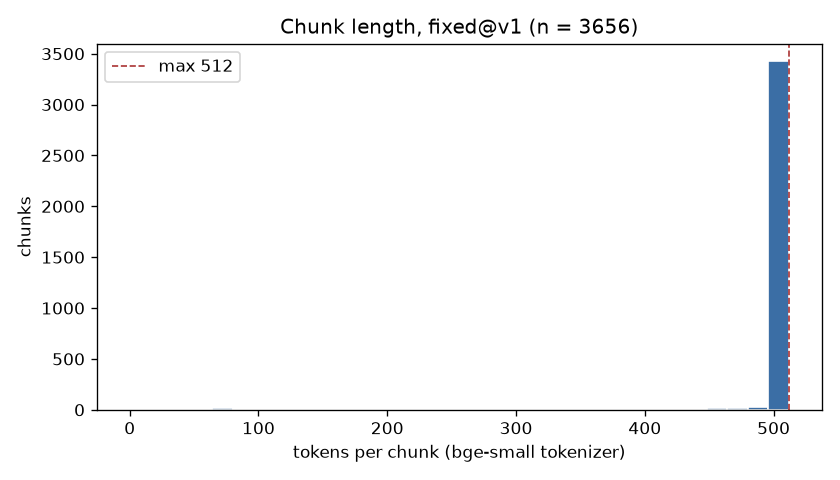
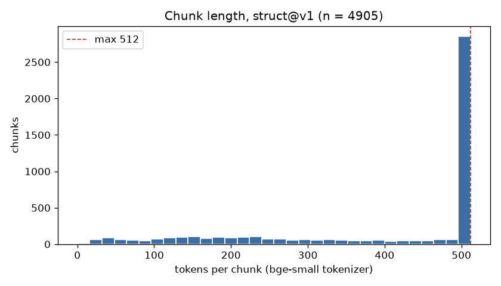

# 02 Chunking, embedding and re-chunking

**Owner:** Sai (chunking strategies, statistics, the real-corpus index and migration run, this report). The embedding, vector database and migration code is Nayan's (#14, #22).

Every number in this report is generated from `reports/artifacts/` by `make report-chunking`, which fills the marked tables. Nothing between the `AUTO` markers is typed by hand. A table that still says "Not produced yet" means the run it needs has not happened.

**Reproduce, in order:**

```bash
make chunk STRATEGY=fixed            # data/chunks/fixed@v1.jsonl + chunk stats + histogram
make index STRATEGY=fixed            # Chroma + BM25 for fixed@v1, embedding record
make retrieval-eval CONFIG=b2 SPLIT=dev
make migrate FROM=fixed@v1 TO=struct@v1
make retrieval-eval CONFIG=a1 SPLIT=dev
make chunk STRATEGY=struct           # chunk stats + histogram for struct@v1 (no re-index needed)
make report-chunking                 # fills the tables below
```

## 1. Two chunking strategies

Both strategies read the saved normalized documents in `data/normalized/` and count tokens with the embedding model's own tokenizer (bge-small-en-v1.5), so a chunk's `n_tokens` is exactly what the embedder sees. A chunk's text is sliced from the original document text, not decoded from tokens, so capitalization, punctuation and evidence quotes still match the source.

| | Strategy A: fixed size (`fixed@v1`) | Strategy B: structure-aware (`struct@v1`) |
|---|---|---|
| Code | `src/chunk/fixed.py` | `src/chunk/structure.py` |
| Unit of work | The whole document: every section's text and tables joined | One section (`heading_path`) at a time |
| Rule | Windows of up to 512 tokens, consecutive windows sharing about 64 tokens | A section that fits in 512 tokens, heading included, is one chunk. A longer section's text is cut into windows of up to 512 tokens with about 64 tokens of overlap |
| Headings | Not included; a window can span several sections | The heading path ("Part 107 > Subpart B > § 107.51 Operating limitations") is put in front of every chunk and stored in `heading_path` |
| Tables | Can be cut anywhere | Kept whole if they fit. A bigger table is split by rows, never mid-row, with the header row repeated in every part |

**Window edges fall on word boundaries** (both strategies, #44). bge splits rare words into pieces, and a window cut between two pieces would start a chunk with a fragment that re-tokenizes one token longer, which on the first real-corpus run pushed 24 chunks to 513 tokens. Each window therefore shrinks to the last whole word within 512 tokens, and the next one starts at the first whole word inside the overlap, so the overlap is 64 tokens or slightly less and no text is skipped. Only a single "word" longer than a whole window (for example a very long URL) is cut mid-word.

**Why compare them:** our sources are organized by headings: the 14 CFR sections from GovInfo's 2025 annual edition (one document per section), the parts of each Federal Register rule (and its GovInfo PDF), and the Know Before You Fly guidance pages and PDFs. A fixed window can join the end of one rule to the start of the next, and loses the heading that says which rule it is. Structure-aware chunks keep one topic per chunk and carry the heading words into the embedding and the BM25 index, at the cost of uneven chunk lengths.

## 2. Chunk counts and token lengths

<!-- BEGIN AUTO:chunk_counts -->
| Strategy | Chunks | Docs | Chunks/doc (median) | Min | Median | p95 | Max | Mean | Over 512 |
|---|---|---|---|---|---|---|---|---|---|
| `fixed@v1` | 3656 | 160 | 1 | 10 | 512 | 512 | 512 | 497 | 0 |
| `struct@v1` | 4905 | 160 | 1 | 4 | 511 | 512 | 512 | 395.2 | 0 |

Token counts use the bge-small tokenizer. Source: `reports/artifacts/chunk_stats.json`.
<!-- END AUTO:chunk_counts -->

### Token-length histograms

<!-- BEGIN AUTO:histograms -->



<!-- END AUTO:histograms -->

### Chunks by page type

<!-- BEGIN AUTO:page_types -->
| Page type | `fixed@v1` chunks | `struct@v1` chunks |
|---|---|---|
| `guide_page` | 29 | 94 |
| `regulation_summary` | 3556 | 4644 |
| `toolkit_pdf` | 71 | 167 |
<!-- END AUTO:page_types -->

## 3. Chunk IDs

```
chunk_id = {doc_id}::{strategy}@{version}::{ordinal:04d}
example:   a1b2c3d4e5f6::struct@v1::0007
```

- `doc_id` is the first 12 hex characters of the SHA-256 of the document's canonical URL. Scheme and host are lowercased, and default ports, fragments, tracking parameters and trailing slashes are removed. The same page therefore gets the same ID on every run.
- `ordinal` is the chunk's position in its document for that strategy.
- The same normalized text and strategy always produce the same IDs, so upserts are idempotent: re-indexing replaces chunks instead of duplicating them. It also makes the orphan check in section 5 possible, because the full set of IDs that should exist is known in advance.
- Each chunk also stores `strategy` (the full tag, e.g. `fixed@v1`), `doc_id` and `chunk_hash` (SHA-256 of its text) as metadata.

Code: `src/common/contracts.py` (`doc_id_for`, `chunk_id_for`), tested in `tests/test_contracts.py`.

## 4. Embedding and the vector database

<!-- BEGIN AUTO:embedding -->
| Setting | Value |
|---|---|
| Model | `BAAI/bge-small-en-v1.5` |
| Hugging Face revision | `5c38ec7c405ec4b44b94cc5a9bb96e735b38267a` |
| Dimension | 384 |
| Distance (checked on the live collection) | cosine |
| L2-normalized | True |
| Measured vector norms (sample) | 0.9999999 to 1.0000001 |
| Query instruction | "Represent this sentence for searching relevant passages: " |
| sentence-transformers / chromadb | 6.1.0 / 1.5.9 |
| Indexed strategy, chunks in collection | `fixed@v1`, 3656 |

Source: `reports/artifacts/embedding_info.json`.
<!-- END AUTO:embedding -->

- **Normalization and metric agree.** Every vector is L2-normalized when it is embedded, and `embed()` raises an error if any norm differs from 1 by more than 0.001. The Chroma collection is created with cosine distance and checked every time it is opened, because Chroma's default is L2. With unit-length vectors, cosine and inner product give the same ranking. Unit tests check both settings, so a mismatch fails the build instead of silently degrading ranking (`tests/test_index.py`).
- **Queries get bge's retrieval instruction** ("Represent this sentence for searching relevant passages: "). Stored chunks do not.
- **Chroma never embeds by itself** (`embedding_function=None`); only our bge vectors are stored.
- **Metadata filtering and delete:** `page_type` and `strategy` filters, and delete by filter, are tested on the fixtures.

Code: `src/index/embed.py`, `src/index/store.py`.

## 5. Re-chunking without re-crawling, and without orphans

`make migrate FROM=fixed@v1 TO=struct@v1` (`src/index/migrate.py`) follows proposal §6.3:

1. Load `data/normalized/`. The crawler is never imported; a test checks this.
2. Generate the `struct@v1` chunks, and write the chunk file and a manifest listing every expected `chunk_id`.
3. Delete every chunk with `strategy == fixed@v1` from Chroma by metadata filter, plus any stale `struct@v1` chunk that is not in the manifest.
4. Upsert the new chunks by their deterministic IDs, and rebuild the BM25 index from the same chunk file.
5. **Orphan check:** index IDs − manifest IDs must be empty, manifest IDs − index IDs must be empty, and no chunk may still be tagged `fixed@v1`. Otherwise the command exits with an error and lists the mismatched IDs.

<!-- BEGIN AUTO:migration -->
| Step | Result |
|---|---|
| Normalized documents read (no re-crawl) | 160 |
| Index before | `fixed@v1`: 3656 |
| `struct@v1` chunks generated | 4905 |
| `fixed@v1` chunks deleted (metadata filter) | 3656 |
| Stale `struct@v1` chunks deleted | 0 |
| `struct@v1` chunks upserted | 4905 |
| Index after | `struct@v1`: 4905 |
| Index IDs − manifest IDs | 0 |
| Manifest IDs − index IDs | 0 |
| Chunks still tagged `fixed@v1` | 0 |
| Orphan check | **PASS** |
| Commit, run at | `44e6731`, 2026-10-10T22:03:36+00:00 |

Sources: `reports/artifacts/migration.json`, full log in `reports/artifacts/migration_log.txt`.
<!-- END AUTO:migration -->

## 6. Effect on retrieval (dev split)

B2 and A1 differ only in the chunk strategy (a unit test checks that each ablation step changes one switch), so this comparison isolates the chunking change.

<!-- BEGIN AUTO:dev_metrics -->
_Not produced yet: dev retrieval metrics for b2, a1. Run `make retrieval-eval CONFIG=b2 SPLIT=dev` and `make retrieval-eval CONFIG=a1 SPLIT=dev`._
<!-- END AUTO:dev_metrics -->

## 7. Findings

Numbers below are from the tables above and `reports/artifacts/chunk_stats.json` (160 documents, commit `44e6731`).

- **Structure-aware chunking makes more, shorter chunks.** `struct@v1` has 4905 chunks against 3656 for `fixed@v1`, with a mean of 395.2 tokens against 497. A section is never merged with its neighbour, so short sections become short chunks of their own (the shortest `struct@v1` chunk is 4 tokens, against 10 for `fixed@v1`), and every long section ends in a partial window.
- **Most documents fit in one chunk under both strategies** (median 1 chunk per document). The 111 CFR sections are one document per section, so many documents are short.
- **The long documents hit the 512-token cap.** 2664 `fixed@v1` chunks and 2174 `struct@v1` chunks are exactly 512 tokens; none is longer (Over 512 = 0 for both).
- **Structure-aware chunks repeat text on purpose.** They hold 1938586 tokens in total against 1816860 for `fixed@v1`, because every chunk of a section carries its heading path and every long section adds its own overlap.
- **Page types:** `regulation_summary` (the CFR sections, the Federal Register rules and their GovInfo PDFs) accounts for 3556 `fixed@v1` and 4644 `struct@v1` chunks; Know Before You Fly pages (`guide_page`) and PDFs (`toolkit_pdf`) account for the rest.
- _Pending the dev split: whether structure-aware chunks changed Recall@5, MRR and nDCG@10 on dev, and by how much (section 6; uncertainty in reports 04 and 06)._
- _Pending the error analysis (06): chunk-boundary failures, with an example._

## 8. Limitations

- Token counts use the bge tokenizer, so they are exact for embedding but not for the generator's own token count.
- Structure-aware chunking depends on the headings that extraction recovers. A document with poor heading structure (for example, a scanned PDF) falls back to large sections split by windows.
- After the migration only `struct@v1` is indexed. Baselines B1 and B2 use `fixed@v1`, so `make index STRATEGY=fixed` must run again before the final test-split run (both strategies can live in the collection at once).
